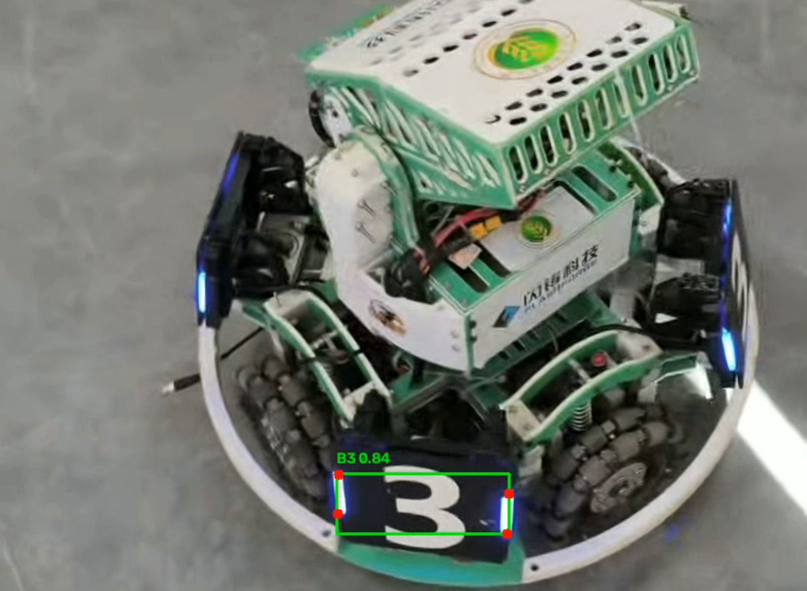

# yolo-armor-inference
YOLO26n装甲板视频推理作业
## 1. 项目完成的功能
本项目基于 YOLOv26 模型，针对自行拍摄的装甲板视频进行推理。实现了以下核心功能：
- 加载指定模型权重，读取本地视频。
- 对视频逐帧进行推理，检测目标装甲板。
- 在画面中绘制检测框、类别（如 B3、R1 等）、置信度，以及装甲板的 4 个关键点。
- 将带有可视化标注的视频保存为本地文件，保持与原视频内容一致，画面流畅。

## 2. 运行环境
- **Python 版本**：3.8+
- **主要依赖**：ultralytics, opencv-python, numpy（详见 `requirements.txt` 文件）
- **计算设备**：**CPU**（本机未配置GPU，代码中已设定 `device='cpu'`，满足非实时推理需求）

## 3. 模型权重的准备与放置位置
模型权重由老师提供。请将下载好的 `best.pt` 文件放置于项目根目录下的 `weights` 文件夹中。
最终路径应当为：`weights/best.pt`

## 4. 安装步骤、实际运行命令和结果保存位置
请确保已安装Python环境，并在项目终端执行以下命令：
1. 安装依赖：
   ```bash
   pip install -r requirements.txt
2. 实际运行命令：
    ```bash
   python infer.py
3. 结果保存位置：
    自动保存在该项目根目录下，文件名为result_video.mp4

## 5. 视频拍摄地点，时长及场景说明
拍摄地点：水建学院D414实验室
拍摄设备：手机横屏拍摄
视频时长：12秒
场景说明：改变镜头距离和拍摄角度，观察模型在不同情况下的识别表现

## 6. 结果展示
    

## 7. 实际识别表现，遇到的问题及处理方法
实际识别表现：画面清晰,装甲板正对镜头时，模型能够准确识别出目标，置信度达到0.87，且4个关键点定位准确
问题：装甲板倾斜角度过大,光照不均时，画面出现漏检现象
方法：检查视频输入频率和图像质量，确认模型推理过程无代码错误
